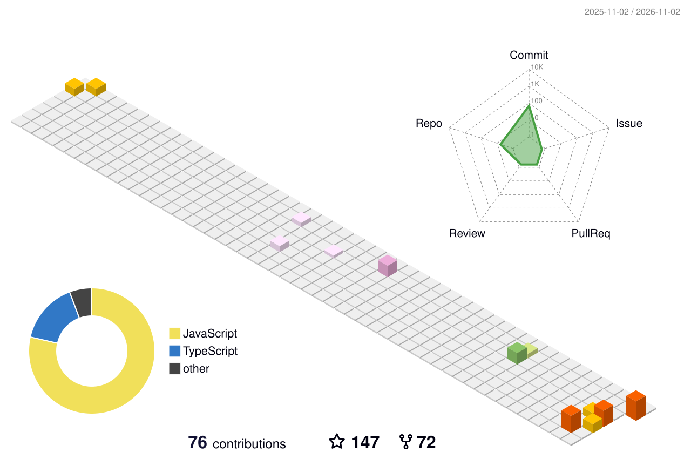

**Web, masaüstü ve bot uygulamaları geliştiriyorum · 2016'dan beri kod yazıyorum · 🇹🇷 Türkiye**

---

## Hakkımda

Arduino ve Minecraft modlarıyla başladım; bugün web platformları, masaüstü uygulamaları ve Discord botları geliştiriyorum. **Rigel Techs** çatısı altında ürünleri fikirden yayına kadar uçtan uca hazırlıyorum.

- 🔭 **Şu an:** Gecko tabanlı **Rigel Browser** ve **TürkAnimeList** üzerinde çalışıyorum
- 🧩 **Odak:** Next.js / React, Node.js + Prisma, Electron ve Tauri
- 💬 **Açığım:** Freelance projelere ve açık kaynak iş birliklerine

---

## Öne Çıkan Projeler

| Proje | Açıklama | Teknolojiler |
| :-- | :-- | :-- |
| **[Rigel Browser](https://github.com/oktayyavuz/RigelWebBrowser)** | Firefox (Gecko) tabanlı kişisel tarayıcı: 5 düzen, `Ctrl+K` komut paleti, çalışma alanları ve mod mağazası | `Gecko` `JavaScript` `CSS` |
| **[Rigel Download Manager](https://github.com/oktayyavuz/rigel-download-manager)** | Linux için açık kaynak IDM alternatifi: tarayıcıdaki videoyu yakalar, `yt-dlp` + `aria2` ile indirir | `Tauri` `Next.js` `Chrome MV3` |
| **[TürkAnimeList](https://github.com/oktayyavuz/turkanimelist)** | Türkçe altyazılı anime platformu; puanlama, yorumlar ve izleme listeleri · [demo](https://tal.oktaydev.com) | `Next.js 16` `React 19` `Prisma` |
| **[Otaku Office](https://github.com/oktayyavuz/otakuoffice)** | Not defteri, PDF araçları ve yapılacaklar listesini bir araya getiren masaüstü uygulaması | `Electron` `React` `TypeScript` |
| **[WeebPlay](https://github.com/oktayyavuz/weebplay)** | PiP, kaldığın yerden devam ve hareket kontrollü medya oynatıcı | `Flutter` |
| **[Rimuru Bot](https://github.com/oktayyavuz/Rimuru-Discord.js-v14-Bot)** | Toplulukta altyapı olarak kullanılan genel amaçlı moderasyon botu · ⭐ 65 | `Discord.js v14` |
| **[Frieren Bot](https://github.com/oktayyavuz/frieren-bot)** | Frieren temalı büyü, ekonomi ve müzik sistemli Discord botu | `Discord.js` |

---

## Teknolojiler

 

---

## Katkı Grafiği

<picture>
  <source media="(prefers-color-scheme: dark)" srcset="https://raw.githubusercontent.com/oktayyavuz/oktayyavuz/output/profile-night-view.svg">
  
</picture>

---

İş birliği ve proje fikirleri için: <a href="mailto:oktayyavuz_1@outlook.com">oktayyavuz_1@outlook.com</a>

